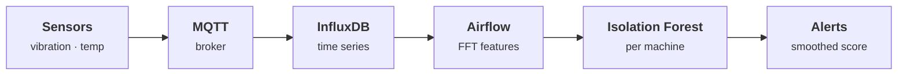

# Predictive maintenance from vibration

> Sensors on industrial machines stream vibration and temperature; an unsupervised model flags a failing bearing days ahead.

**Interactive demo:** [natanmartins.com.br/projects/iot-maintenance](https://natanmartins.com.br/projects/iot-maintenance/) · [versão em português](https://natanmartins.com.br/pt/projects/iot-maintenance/)

**Status:** in construction. This README separates what exists from what is planned, and is updated as parts ship.

## The problem

Failures are rare, so there is almost nothing labelled to learn from. The model has to learn what normal looks like for each machine and notice drift, without drowning operators in false alarms.

## Architecture



1. Sensors publish over MQTT; a bridge writes raw readings to InfluxDB.
2. Airflow computes spectral features (FFT bands, RMS, kurtosis) per machine every few minutes.
3. An Isolation Forest per machine scores each window; a smoothed score crossing a threshold opens an alert.
4. This is the one project designed to run live on this server, with simulated machines.

**Stack:** MQTT (Mosquitto) · InfluxDB · Apache Airflow · scikit-learn · Grafana

## What exists today

### Real
- The FFT, the features (RMS, kurtosis, crest factor, band energies) and the Isolation Forest are implemented from scratch and run in your browser.
- The model is trained when the page loads, only on healthy windows; the threshold is the 99.5th percentile of their scores.
- Lead times in the timeline come from the model’s actual alerts in your run.

### Simulated in the browser demo
- The vibration signal is synthetic: shaft harmonics, noise, and bearing impacts at the outer-race defect frequency ringing a structural resonance.
- Degradation follows a fixed 21-day exponential curve; time is compressed.

### Not built yet (roadmap)
- [ ] MQTT broker, InfluxDB and Airflow running live on this server
- [ ] Validation on a public bearing dataset (e.g. NASA IMS / CWRU)
- [ ] Grafana dashboard

## Repository layout

```
demo/   the simulation that powers the interactive page, with tests that check its claims
```

The production pipeline will live alongside it (`pipeline/`, `docker-compose.yml`) as the roadmap items land.

## Run the demo tests

Requires Node.js 22+.

```bash
cd demo
npm test
```

## License

MIT © 2026 Natan Oliveira Martins
